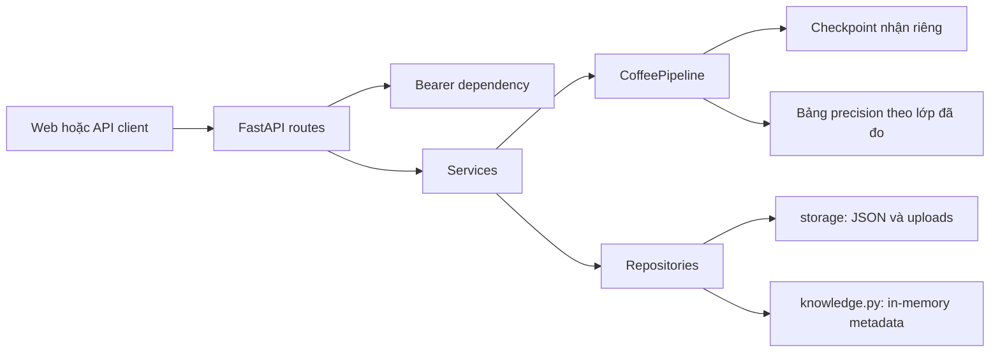

# Kiến trúc ứng dụng

## Trách nhiệm

- `api/routes`: hợp đồng HTTP; `dependencies` xác thực Bearer hoặc trả `default_user` cho khách.
- `core/config`: nạp `.env` một lần, ưu tiên biến môi trường, tính đường dẫn theo repository. `core/security`: PBKDF2 và token HMAC giữ từ bản cũ.
- `services/diagnosis`: kiểm định ảnh, suy luận, lưu ảnh và lịch sử; dọn ảnh nếu ghi lịch sử lỗi.
- `repositories/json_store`: đọc/ghi users và histories, lưu JSON nguyên tử qua file tạm và `os.replace`; ảnh ở uploads, dữ liệu bệnh học chỉ đọc.
- `inference`: loader/kiến trúc classifier, square slicing/NMS, tiền xử lý, điều phối ensemble và vẽ overlay. Không phụ thuộc HTTP hoặc users/history.
- `static/api.js`: tập trung HTTP cùng origin; `app.js` quản lý DOM và tương tác.

## Khởi động và tương thích

`app.main:create_app` tạo ứng dụng. Lifespan kiểm tra model, dữ liệu bệnh học và nạp pipeline một lần qua `inference.get_pipeline`; hàm này quản lý cache và kiểm tra tên lớp bệnh. ML chỉ được import khi startup hoặc suy luận cần dùng. Suy luận dùng threadpool và khóa để tránh truy cập đồng thời model. `main.py` gốc chuyển tiếp sang ứng dụng mới.

Pipeline dùng [Ensemble Precision](precision-ensemble.md): đồng thuận thì giữ nhãn và confidence cao hơn; bất đồng thì so precision theo nhãn dự đoán của mỗi nhánh, bằng nhau chọn Big. CSV precision được nạp một lần lúc khởi tạo, độc lập với nhãn của ảnh tải lên. Các alias method `predict_ensemble_v4`/`predict_ensemble_v5` gọi cùng chính sách precision; không còn nhánh luật cũ. Top-2 và cờ phân vân chỉ phục vụ hiển thị. API giữ các trường kết quả hiện tại và bổ sung trace precision trong `details`.

Khi thêm nghiệp vụ, đặt vào service; persistence vào repository; request/response vào schemas. Chi tiết chọn nhánh nằm trong `inference/precision.py`; module này không nạp model và có thể kiểm thử với dự đoán lưu sẵn.

`storage/` độc lập với code và model. Dữ liệu cũ chỉ được chuyển khi chạy script; nguồn giữ nguyên và `croods` được đọc tương thích. Không đưa lịch sử thật vào clone mới.

Khóa asyncio và JSON chỉ bảo vệ trong một tiến trình. Muốn nhiều worker/bản ứng dụng cần database và migration riêng. Tài khoản khách là danh tính chung, không phải phiên riêng từng trình duyệt.
