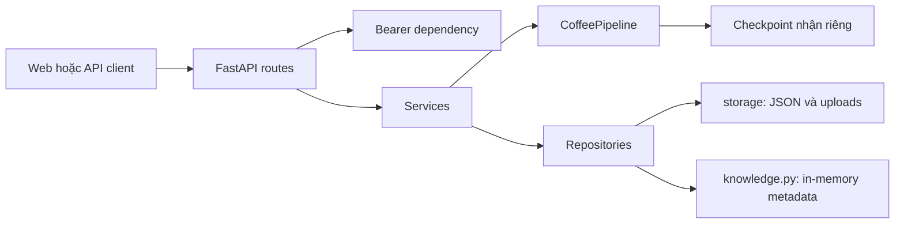

# Kiến trúc ứng dụng

## Trách nhiệm

- `api/routes`: hợp đồng HTTP; `dependencies` xác thực Bearer hoặc trả `default_user` cho khách.
- `core/config`: nạp `.env` một lần, ưu tiên biến môi trường, tính đường dẫn theo repository. `core/security`: PBKDF2 và token HMAC giữ từ bản cũ.
- `services/prediction_service`: kiểm định ảnh, suy luận, lưu ảnh và lịch sử; dọn ảnh nếu ghi lịch sử lỗi.
- `repositories/json_store`: đọc/ghi users và histories, lưu JSON nguyên tử qua file tạm và `os.replace`; ảnh ở uploads, dữ liệu bệnh học chỉ đọc.
- `inference`: nạp Big, phát hiện vùng bệnh bằng YOLO, tiền xử lý và vẽ kết quả. Không phụ thuộc HTTP hoặc users/history.
- `static/api.js`: tập trung HTTP cùng origin; `app.js` quản lý DOM và tương tác.

## Khởi động và tương thích

`app.main:create_app` tạo ứng dụng. Lifespan kiểm tra model, dữ liệu bệnh học và nạp pipeline một lần qua `inference.get_pipeline`; hàm này quản lý cache và kiểm tra tên lớp bệnh. ML chỉ được import khi startup hoặc suy luận cần dùng. Suy luận dùng threadpool và khóa để tránh truy cập đồng thời model. `main.py` gốc chuyển tiếp sang ứng dụng mới.

Pipeline: YOLO → Big → hiển thị top 2 khi confidence ≤ 75%. Xem [luồng dự đoán](inference.md). Logic ở `inference/pipeline.py`; schema API ở `schemas/prediction.py`.

`storage/` độc lập với code và model. Dữ liệu cũ chỉ được chuyển khi chạy script; nguồn giữ nguyên và `croods` được đọc tương thích. Không đưa lịch sử thật vào clone mới.

Khóa asyncio và JSON chỉ bảo vệ trong một tiến trình. Muốn nhiều worker/bản ứng dụng cần database và migration riêng. Tài khoản khách là danh tính chung, không phải phiên riêng từng trình duyệt.
